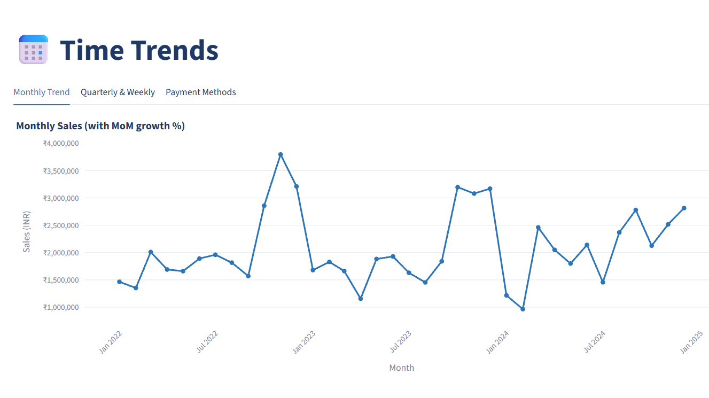

# RetailPulse — Indian Retail Sales Intelligence

> Python · Pandas · MySQL · Streamlit · Plotly

A data analytics project where I analyse 10,000 Indian retail sales transactions from 2022 to 2024, store them in MySQL, and show the results in a Streamlit dashboard.

**Live Dashboard:** [retaisalesintelligence.streamlit.app](https://retaisalesintelligence.streamlit.app)

---

## Why I Built This

I am a final year student looking for Data Analyst jobs. I built this project to practise the full workflow of a real data job — cleaning data, loading it into a database, writing SQL, and building a dashboard.

---

## About the Dataset

The data is synthetic — I generated it myself using Python.

- 10,000 rows of Indian retail transactions
- Date range: January 2022 to December 2024
- 8 product categories, 12 Indian states
- Columns: order date, product, category, quantity, unit price, discount, sales amount, profit, state, city, payment method
- Currency: INR

---

## Dashboard Screenshots

### Overview


### Product & Category


### Time Trends


### Regional


---

## Project Structure

```
├── app.py                 → Streamlit dashboard
├── requirements.txt       → Python packages
├── .env.example           → MySQL credentials template
├── src/                   → Python pipeline and analytics
├── dashboard/             → Chart and UI components
├── sql/                   → 6 SQL scripts, 50+ queries
├── data/                  → Raw and processed CSV files
├── screenshots/           → Dashboard screenshots
├── README.md              → This file
└── RESULTS.md             → All findings and KPIs
```

---

## How to Run It Locally

```bash
# 1. Clone the repo
git clone https://github.com/themanroshan/Retail_Sales_Intelligence.git
cd Retail_Sales_Intelligence

# 2. Create virtual environment
python -m venv .venv
.venv\Scripts\activate

# 3. Install dependencies
pip install -r requirements.txt

# 4. Generate data and run pipeline
python src/pipeline.py --no-db

# 5. Launch dashboard
streamlit run app.py
```

Dashboard opens at **http://localhost:8501**

If you want to use MySQL as well, copy `.env.example` to `.env`, add your MySQL password, and run `python src/pipeline.py` without the `--no-db` flag.

---

## Results

See **[RESULTS.md](RESULTS.md)** for all findings — category performance, regional breakdown, seasonal trends, and discount impact.

---

## Note

This is a learning project. The data is synthetic. I do not claim any of the numbers reflect a real business.

---

Made by **Roshan Manjal**  
GitHub: [themanroshan/Retail_Sales_Intelligence](https://github.com/themanroshan/Retail_Sales_Intelligence)  
Live: [retaisalesintelligence.streamlit.app](https://retaisalesintelligence.streamlit.app)
