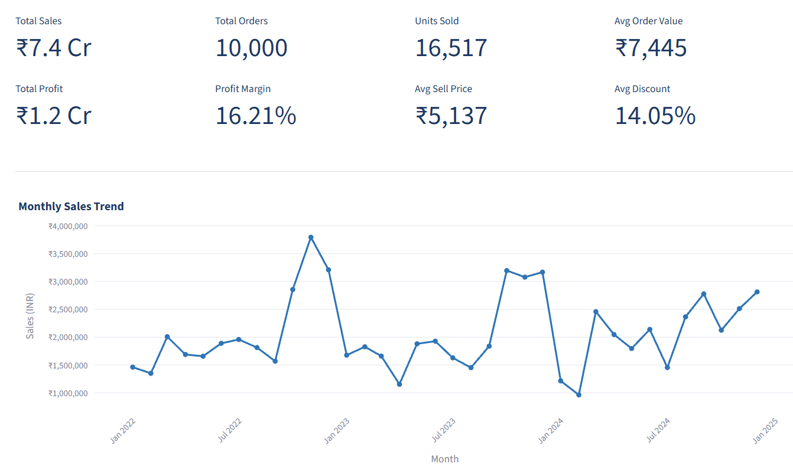
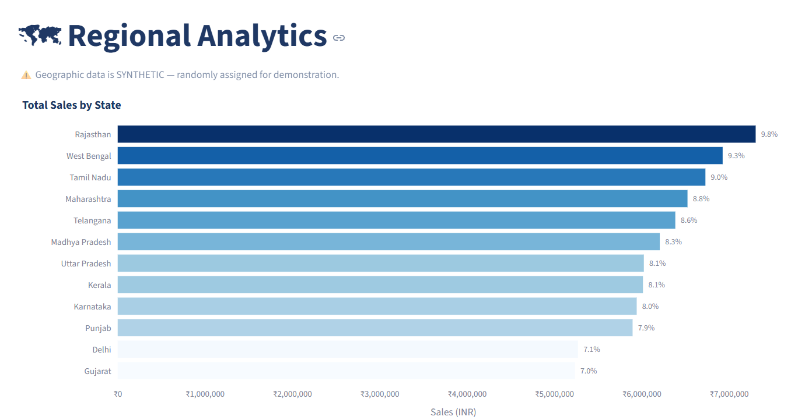

# RetailPulse — Indian Retail Sales Intelligence

An end-to-end data analytics project built to analyse retail sales performance across product categories, regions, and time periods using Python, MySQL, SQL, and Streamlit.

> **Data notice:** This project uses a synthetic dataset generated for demonstration purposes. All figures are simulated and do not represent any real company's performance.

---

## Dashboard Screenshots

### Executive Overview


### Product & Category Analysis


### Time Trends


### Regional Analysis


---

## What This Project Does

A retail business wants to understand which product categories drive the most revenue, how sales vary by region and season, and how discounting affects profitability. This project answers those questions end-to-end:

1. Generates a 10,000-row Indian retail transactions dataset
2. Cleans and validates the data through a Python pipeline
3. Loads it into a MySQL star schema database
4. Answers 14 business questions using SQL
5. Visualises insights in a 5-page interactive Streamlit dashboard
6. Exports analysis to an Excel workbook

---

## Tech Stack

| Tool | Purpose |
|------|---------|
| Python 3.11+ | ETL pipeline, analytics, dashboard |
| Pandas / NumPy | Data cleaning and transformation |
| MySQL 8.0 | Star schema database |
| Streamlit | Interactive dashboard |
| Plotly | Charts and visualisations |
| OpenPyXL | Excel report generation |
| Pytest | Automated testing |
| Git / GitHub | Version control |

---

## Project Structure

```
RetailPulse/
│
├── app.py                  # Streamlit dashboard (5 pages)
├── requirements.txt        # Python dependencies
├── .env.example            # MySQL credentials template
│
├── src/                    # Python source code
│   ├── generate_data.py    # Synthetic data generator
│   ├── pipeline.py         # ETL orchestration
│   ├── data_cleaning.py    # 11 cleaning rules + audit trail
│   ├── data_validation.py  # 17 validation checks
│   ├── transformations.py  # Dimension table builders
│   ├── analytics.py        # KPI and aggregation functions
│   ├── database.py         # MySQL connection layer
│   └── excel_export.py     # Excel workbook builder
│
├── dashboard/              # Dashboard components and charts
│   ├── components.py
│   └── charts.py
│
├── sql/                    # MySQL scripts
│   ├── 01_database_setup.sql
│   ├── 02_create_tables.sql
│   ├── 03_data_quality_checks.sql
│   ├── 04_exploratory_analysis.sql
│   ├── 05_business_analysis.sql   # 14 business questions
│   └── 06_advanced_analysis.sql   # Window functions, CTEs
│
├── data/
│   ├── raw/                # Raw CSV (generated by pipeline)
│   ├── processed/          # Cleaned CSV (used by dashboard)
│   └── sample/             # 500-row sample
│
├── docs/                   # Project documentation
│   ├── DATA_DICTIONARY.md
│   ├── KPI_DEFINITIONS.md
│   ├── DATA_MODEL.md
│   ├── DATA_QUALITY_REPORT.md
│   ├── BUSINESS_INSIGHTS.md
│   ├── BUSINESS_REQUIREMENTS.md
│   └── LIMITATIONS.md
│
├── notebooks/
│   └── 01_retail_eda.ipynb
│
├── excel/
│   └── RetailPulse_Analysis.xlsx  # 10-sheet Excel report
│
├── tests/                  # Pytest test suite (74 tests)
│   ├── test_data_cleaning.py
│   ├── test_data_validation.py
│   ├── test_analytics.py
│   ├── test_database.py
│   └── test_pipeline.py
│
└── screenshots/
```

---

## Key Numbers

| Metric | Value |
|--------|-------|
| Dataset rows | 10,000 transactions |
| Date range | Jan 2022 – Dec 2024 |
| Product categories | 8 |
| Indian states covered | 12 |
| Total simulated sales | ₹7.44 Crore |
| SQL queries written | 50+ |
| Pytest tests | 67 passed, 7 skipped |
| Validation checks | 17 / 17 PASS |
| Excel sheets | 10 |

---

## Database Design — Star Schema

```
        dim_product
            |
dim_date — fact_sales — dim_location
```

- **fact_sales** — one row per order line (order_id + product_id)
- **dim_product** — product name, category, sub-category
- **dim_location** — state and city
- **dim_date** — year, month, quarter, week, day derived from order date

---

## Business Questions Answered

1. What is total sales revenue?
2. How many orders and units were sold?
3. Which categories contribute most to sales?
4. Which products are top performers?
5. Which states and cities generate the most revenue?
6. What is the monthly sales trend?
7. What are the strongest and weakest sales months?
8. What is the average order value?
9. What is the average quantity per order?
10. Which products are growing vs. declining year over year?
11. How concentrated is sales across categories?
12. What is the impact of discounting on profit margins?
13. What is the profit contribution by category?
14. How do payment methods split across orders?

---

## Dashboard Pages

| Page | What it shows |
|------|---------------|
| Overview | 8 KPI cards, monthly trend, category breakdown |
| Products | Category margins, sub-category treemap, top 15 products, discount analysis |
| Time Trends | Monthly trend, heatmap, quarterly, day-of-week, payment methods |
| Regional | Sales by state, top cities, state × category heatmap |
| Data Quality | Row counts, null values, cleaning rules, column schema |

---

## Setup — Quick Start

```bash
# 1. Clone
git clone https://github.com/themanroshan/Retail_Sales_Intelligence.git
cd Retail_Sales_Intelligence

# 2. Create virtual environment
python -m venv .venv
.venv\Scripts\activate        # Windows

# 3. Install dependencies
pip install -r requirements.txt

# 4. Run the pipeline (generates data, no MySQL needed)
python src/pipeline.py --no-db

# 5. Launch dashboard
streamlit run app.py
```

The dashboard opens at **http://localhost:8501**

---

## MySQL Setup (Optional)

```bash
# 1. Copy and fill in credentials
copy .env.example .env

# 2. Run pipeline with MySQL loading
python src/pipeline.py

# 3. Run SQL scripts in MySQL Workbench
#    sql/01_database_setup.sql  → sql/06_advanced_analysis.sql
```

---

## Run Tests

```bash
python -m pytest tests/ -v
# Result: 67 passed, 7 skipped (MySQL tests skip when DB not configured)
```

---

## Generate Excel Report

```bash
python src/excel_export.py
# Output: excel/RetailPulse_Analysis.xlsx (10 sheets)
```

---

## Limitations

- Dataset is synthetic — findings demonstrate methodology, not real market data
- No customer IDs — customer retention and LTV analysis are not possible
- Profit margins are simulated, not from real cost data
- Geographic assignments are random — regional patterns are illustrative only

See `docs/LIMITATIONS.md` for full details.

---

## Author

**Roshan Manjal**
