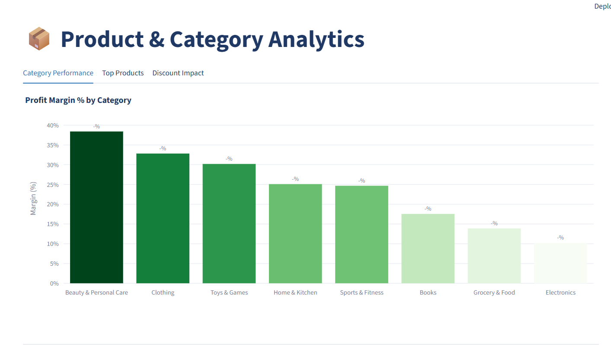

# RetailPulse — Indian Retail Sales Intelligence

An end-to-end data analytics project analysing retail sales performance across product categories, regions, and time periods.

Built with Python, MySQL, SQL, and Streamlit.

> **Note:** Uses a synthetic dataset generated for portfolio demonstration. All figures are simulated.

---

## Dashboard

### Overview


### Product & Category


### Time Trends


### Regional


---

## Tech Stack

Python · Pandas · MySQL · SQL · Streamlit · Plotly · OpenPyXL · Pytest

---

## Project Structure

```
├── app.py                  → Streamlit dashboard (5 pages)
├── requirements.txt        → Python dependencies
├── .env.example            → MySQL credentials template
│
├── src/                    → Python pipeline and analytics
│   ├── generate_data.py    → Synthetic data generator
│   ├── pipeline.py         → ETL: clean, validate, load
│   ├── data_cleaning.py    → 11 cleaning rules
│   ├── data_validation.py  → 17 validation checks
│   ├── analytics.py        → KPI calculations
│   ├── database.py         → MySQL connection
│   └── ...
│
├── dashboard/              → Chart and UI components
├── sql/                    → 6 SQL scripts, 50+ queries
├── data/                   → Raw and processed CSV files
├── screenshots/            → Dashboard screenshots
│
├── README.md               → This file
└── RESULTS.md              → All findings and KPIs
```

---

## Quickstart

```bash
# 1. Clone
git clone https://github.com/themanroshan/Retail_Sales_Intelligence.git
cd Retail_Sales_Intelligence

# 2. Create virtual environment
python -m venv .venv
.venv\Scripts\activate

# 3. Install dependencies
pip install -r requirements.txt

# 4. Generate data and run pipeline
python src/pipeline.py --no-db

# 5. Launch dashboard
streamlit run app.py
```

Dashboard opens at **http://localhost:8501**

---

## MySQL Setup (Optional)

```bash
copy .env.example .env       # fill in your MySQL password
python src/pipeline.py       # loads data into MySQL
# Then open sql/ scripts in MySQL Workbench
```

---

## Results

See **[RESULTS.md](RESULTS.md)** for all KPIs, findings, and business insights.

---

## Author

**Roshan Manjal**
